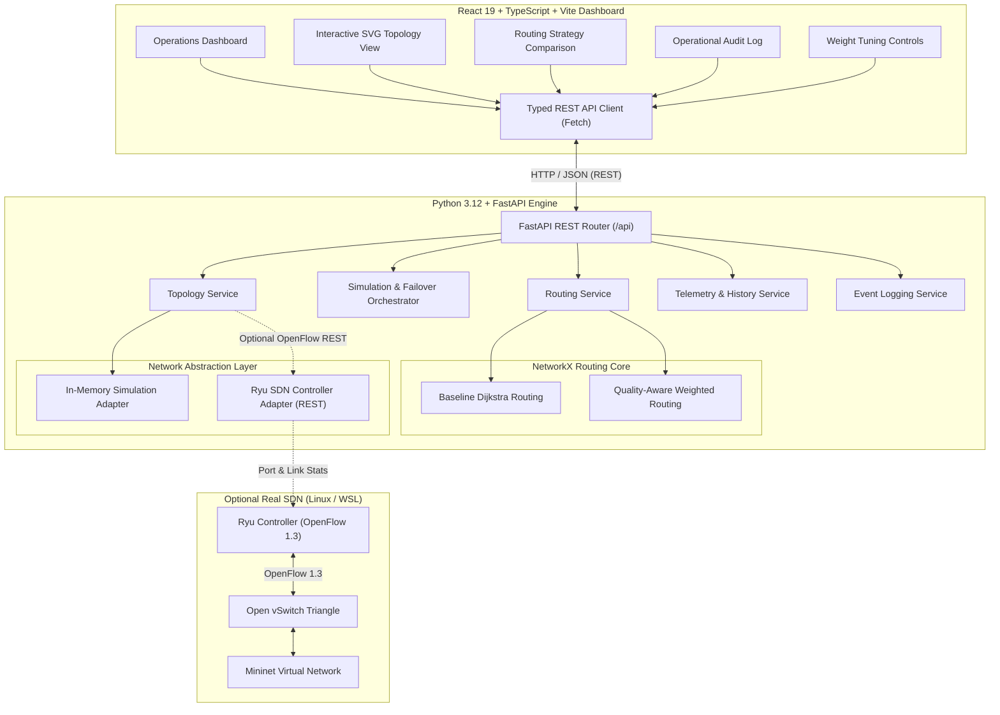

# NetResQ Architecture Specification

## 1. System Overview

**NetResQ** is an adaptive, self-healing network routing system operating primarily at **OSI Layer 3**. It provides dynamic failure detection, automated rerouting, and multi-metric quality-aware path calculation.

The architecture decouples the presentation dashboard from the authoritative backend graph model, enabling reproducible demonstrations with or without specialized SDN physical/virtual hardware.

---

## 2. Component Responsibilities

| Component | Technology | Primary Responsibility |
| :--- | :--- | :--- |
| **Frontend UI** | React 19, TypeScript, Lucide Icons, Vite | Presents interactive network topology, telemetry dashboards, side-by-side routing comparisons, and simulation controls. |
| **API Layer** | FastAPI, Uvicorn, Pydantic | Validates requests, serves REST endpoints, formats JSON errors, configures CORS. |
| **Routing Core** | NetworkX, Python 3 | Authoritative graph model. Computes Dijkstra shortest path and weighted composite quality routes. |
| **Simulation Adapter** | Python In-Memory Graph | Authoritative store of link states (UP/DOWN/DEGRADED), simulated latency, packet loss, and utilization. |
| **SDN Controller Adapter** | Requests, REST API | Interrogates external Ryu/OS-Ken OpenFlow 1.3 controller for discovered topology and port stats. |

---

## 3. Data Flow: From User Click to UI Reroute

1. **User Action:** The operator clicks **"Fail Link"** on link `L_S1_S3` (or changes its latency to 65ms).
2. **API Request:** Frontend issues `POST /api/links/L_S1_S3/fail` (or `/metrics`).
3. **State Mutation:** `SimulationAdapter` marks the link status as `down`.
4. **Graph Pruning:** `build_quality_aware_graph` and `build_baseline_graph` exclude failed links from the NetworkX edge list.
5. **Route Recomputation:** Dijkstra's algorithm computes the optimal alternate path (`H1 -> S1 -> S2 -> S3 -> H4`).
6. **Benchmark Recording:** Elapsed execution time is measured via monotonic clock (`time.perf_counter()`).
7. **Audit Logging:** An event is logged with severity `WARNING` and timestamp.
8. **UI Refresh:** Frontend receives updated route and topology; the active route glows neon cyan, and the failed link turns red-dashed.
